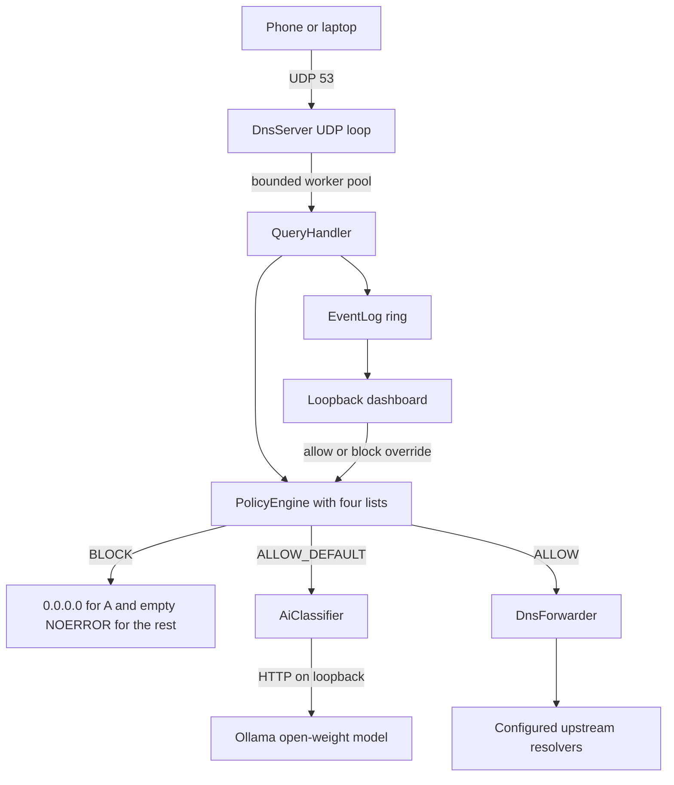

# Tracewall Desktop

A local DNS sinkhole for your laptop or home network: point any device's DNS at
it and it blocks malware, gambling, adult and ad domains from four bundled
lists, showing every decision live in a small web dashboard. When a domain
matches no list, it can ask a local open-weight model served by Ollama for a
second opinion, and it fails open so a missing model never breaks name
resolution.

## Origin and what is new

The filtering engine is not new work. It was written earlier for a university
Android course and lives in [Tracewall](https://github.com/STARFALL088/Tracewall),
a `VpnService` app. This repository is the standalone desktop build.

| Part | Origin | Status |
| --- | --- | --- |
| `tracewall.net.*`, `tracewall.blocklist.*` | Copied from Tracewall at commit `e5c7c0d`, unchanged apart from a provenance header | Authored before the hackathon for a university course |
| Category lists in `lists/` | Copied from the same repository, sourced from Block List Project and abuse.ch | Data, not code; see [NOTICE.md](NOTICE.md) |
| UDP `DnsServer`, `QueryHandler`, argument parsing | Written here | New at the hackathon |
| `OllamaClient` and `AiClassifier` | The classifier started as the app's `AiClassifier`; the HTTP call was split out, the prompt, caching, failure handling and structured output were rewritten here | New at the hackathon |
| Evaluation harness and `eval/domains.tsv` | Written here | New at the hackathon |
| Live dashboard and overrides | Written here | New at the hackathon |
| Tests | Written here | New at the hackathon |

The engine classes were not modified. If you diff them against
`Tracewall/blocklist/src/main/java/tracewall`, the only difference is the header
comment naming the commit they came from.

## Architecture



Decision order is the engine's own: explicit allow beats custom deny, custom
deny beats category, category beats default allow. The model is consulted only
when the result is `ALLOW_DEFAULT`, and its verdict can only block, never
allow.

## Quickstart

Requires a JDK. The wrapper fetches Gradle 8.9 itself; the project has no
third-party runtime dependencies. `gradle.properties` pins the Gradle JVM to
`/usr/lib/jvm/java-17-openjdk`, the path on the machine this was built on. On
another machine, change that line or delete it; the `java.toolchain` block in
`build.gradle.kts` still compiles for Java 17.

```bash
./gradlew test                                  # 53 tests, no network calls in the tests
./gradlew run --args="--lists lists --allow example.com"
```

Then, from another terminal:

```bash
dig @127.0.0.1 -p 5354 xvideos.com              # 0.0.0.0
dig @127.0.0.1 -p 5354 xvideos.com AAAA         # NOERROR, no answers
dig @127.0.0.1 -p 5354 example.com              # forwarded, real answer
python3 scripts/dnsq.py xvideos.com A           # same thing without dig
```

The dashboard is at <http://127.0.0.1:8080>. Its write token is printed at
startup and embedded in the page. The **Ask Tracewall** button in the corner
opens a chat helper, described below.

Useful flags:

| Flag | Meaning |
| --- | --- |
| `--port N` | UDP port, default 5354 |
| `--bind ADDR` | listen address, default `127.0.0.1` |
| `--allow DOMAIN` | allowlist entry, repeatable |
| `--allow-client CIDR` | serve only these clients, repeatable |
| `--upstream IP[,IP]` | upstream resolvers, default `1.1.1.1,8.8.8.8` |
| `--stats-interval N` | stats line every N seconds, 0 disables |
| `--dashboard-port N` | dashboard port, default 8080, 0 disables |

## Adding the AI classifier

The classifier is optional and off unless you name a model. There is no default
model tag on purpose: tags change and a wrong tag just fails at runtime.

```bash
sudo pacman -S ollama
sudo systemctl start ollama
ollama pull <small-model-tag>
```

Pick a roughly 1-4 billion parameter instruction model: this machine has 7 GB of
RAM and no GPU, and a larger model will either not fit or take tens of seconds
per call. Check <https://ollama.com/library> for the exact tag of the model you
want; this README deliberately does not invent one.

```bash
./gradlew run --args="--lists lists --ai-model <tag> --ai-prewarm examples/demo-domains.txt"
```

or set `TRACEWALL_AI_MODEL` instead of `--ai-model`.

What the classifier does:

- asks only about names no list matches, and only after the engine returns
  `ALLOW_DEFAULT`;
- sends only the validated registrable domain, so a hostile query name cannot
  inject instructions into the prompt;
- blocks only `adult`, `gambling` and `malware` at or above the confidence
  threshold, default 0.8;
- caches successful verdicts in `ai-cache.tsv`, so a demo repeats offline;
- remembers failures for 60 seconds and retries, instead of pinning a domain to
  "no opinion" forever;
- keeps the model loaded with `keep_alive: 30m`, uses a short connect timeout
  and a generous first-call read timeout for the cold load;
- can send a JSON schema with an enum of categories via `--ai-format schema`,
  which needs a recent Ollama; the default `json` mode works everywhere.

Ollama serves one request per model at a time by default, so the two classifier
workers can still queue behind each other, and prewarming a dozen names on CPU
takes a while. That is a startup cost: after the cache is filled, a repeated
domain is answered from memory or from `ai-cache.tsv`.

## Ask Tracewall (chat helper)

The dashboard has a small chat panel that answers questions about Tracewall:
how a query is decided, what the stat cards mean, overrides, setup, privacy and
the limits. It works in two modes:

- **Docs only** (default, no model needed): it ranks the sections of
  `src/main/resources/about.md` against the question and shows the best match.
- **Model-backed** (when `--ai-model` or `TRACEWALL_AI_MODEL` is set): the same
  local Ollama model is given the three best sections plus the live counters
  and asked for a short answer. If the model is slow, busy, down or returns
  nothing, the panel falls back to the docs answer and says so.

Notes:

- It only talks. It cannot change policy; for that, use the Override box.
- Recently blocked hostnames are added to the prompt only when the Ollama URL
  is loopback, so `--ai-url` pointing at another machine never receives your
  browsing history.
- One question is sent to the model at a time; a second one asked meanwhile
  gets the docs answer instead of queueing behind a slow CPU model.
- `POST /api/chat` needs the same token and Origin checks as `/api/override`;
  messages are capped at 4 KB and truncated to 500 characters.
- The answers are only as good as `about.md`. If you change behaviour, change
  that file too.

## Trying the AI path without a model

If you want to exercise the classifier, dashboard and demo script before
pulling a model, run the bundled stand-in:

```bash
python3 scripts/fake_ollama.py --port 11500
./gradlew run --args="--lists lists --ai-model fake --ai-url http://127.0.0.1:11500"
```

It answers every request with a keyword guess. It is a development aid, not a
model: its output must never be presented as a real classification, and the
fake deliberately gets names like `sussex-community.net` wrong to show why the
prompt needs counter-examples.

## Protecting a real phone

The phone must be able to reach UDP port 53 on the laptop.

1. Free port 53 on the laptop. `systemd-resolved` owns it by default. Set
   `DNSStubListener=no` in `/etc/systemd/resolved.conf`, then
   `sudo systemctl restart systemd-resolved`. Point the laptop's own resolver at
   something else, for example `1.1.1.1`, so the laptop keeps working.
2. Build once, then run the jar as root:

   ```bash
   ./gradlew fatJar
   sudo java -jar build/libs/tracewall-desktop-1.0.0-all.jar \
     --port 53 --bind 0.0.0.0 --allow-client 192.168.1.0/24 --lists lists
   ```

   Port 53 needs root. Binding to `0.0.0.0` prints a warning because it is an
   open resolver for anything that can reach the machine; restrict it with
   `--allow-client`.
3. On the phone, set the Wi-Fi network to a static IP and set DNS to the
   laptop's LAN address. Leave the gateway as it was.
4. Allow UDP 53 in the laptop firewall, for example
   `sudo ufw allow 53/udp` or the equivalent nftables rule.

Test with `dig @<laptop-ip> -p 53 xvideos.com` from the phone before trusting
it. This setup was **not** verified on a real phone; see the limits below.

## Privacy

Queries and domain names never leave the machine, except to the upstream
resolvers you configure. The model runs locally through Ollama on loopback, so
the domain you are asking about is not sent to a model provider. The dashboard
listens on loopback only. `ai-cache.tsv` and `overrides.tsv` are local files and
are gitignored.

If you point `--ai-url` at a remote Ollama instance, that last guarantee stops
being true. Do not do that for a privacy-sensitive deployment.

## Honest limits

- **Hostname only.** The classifier sees the name, not the page. It will get
  some names wrong in both directions, and the evaluation set is a sanity
  check, not a benchmark.
- **Fail open by design.** A slow, missing or confused model means the query is
  allowed. That is the right default for a filter that must not break the
  network, and the wrong default for a security control.
- **DoH and Private DNS bypass it.** Apps that use their own encrypted resolver,
  direct IP connections or cached addresses never ask this server.
- **No per-device policy.** Every client gets the same rules and the same
  overrides.
- **No channel-level blocking.** DNS sees hostnames, so individual YouTube
  channels or paths cannot be blocked, only whole hosts.
- **Category lists are incomplete.** About 95,000 merged entries; the upstream
  projects publish far more.
- **UDP only, IPv4 upstream.** No DNS-over-TLS upstream and no IPv6 listening.
- **No DNSSEC validation.** The filter relays whatever the upstream resolver
  returns; it does not verify signatures itself, so it inherits the upstream's
  trust model.

## AI tools disclosure

The original Tracewall app was written earlier for a university course with
Codex/GPT-6.1 Sol and Claude. This desktop rewrite, its tests, evaluation
harness and dashboard were built in an OpenCode session running DeepSeek V4.1
Flash. The shipped code calls no AI API at build or run time except the local
Ollama endpoint you configure.

## Testing

`./gradlew test` runs 53 JUnit 5 tests; none of them make a network call:

- 11 classifier tests: domain validation, JSON decoding, one model call per
  registrable domain, cache persistence, failure expiry, malformed output,
  structured output;
- 9 query handler tests: `0.0.0.0` for blocked A, empty NOERROR for blocked
  AAAA, question echo, allowlist precedence, AI threshold, list short-circuit;
- 4 server tests: loopback round trip, garbage input survival, client allowlist,
  CIDR matching;
- 14 dashboard tests: JSON endpoints, token rejection, origin rejection,
  override precedence, chat endpoint auth and input limits, chat widget present;
- 15 chat helper tests: section retrieval, allow/block wording, the four UI
  suggestion chips, off-topic handling, model answer, docs fallback on model
  error or empty answer, busy handling, hostname privacy rule, question
  truncation.

Everything model-related is exercised against an in-process fake Ollama
(`com.sun.net.httpserver`). **No test runs a real model.** The classifier has not
been evaluated on real inference yet; `eval/domains.tsv` exists so that you can,
and the file says plainly that its positives come from the blocklists.

## Layout

```
src/main/java/tracewall/net/        engine, copied from Tracewall
src/main/java/tracewall/blocklist/  engine, copied from Tracewall
src/main/java/tracewall/desktop/    this project
src/main/resources/dashboard.html   the whole UI, no build step
src/main/resources/about.md         knowledge the chat helper answers from
src/test/java/tracewall/desktop/    JUnit 5 tests and fakes
lists/                              four hosts-format category lists
eval/                               labelled sample for the accuracy harness
examples/                           demo domains for --ai-prewarm
docs/                               demo script and submission text
scripts/dnsq.py                     minimal DNS client for manual checks
scripts/fake_ollama.py              stand-in Ollama for manual runs without a model
```

## Licence

MIT, see [LICENSE](LICENSE). The bundled lists have their own terms, see
[NOTICE.md](NOTICE.md).
